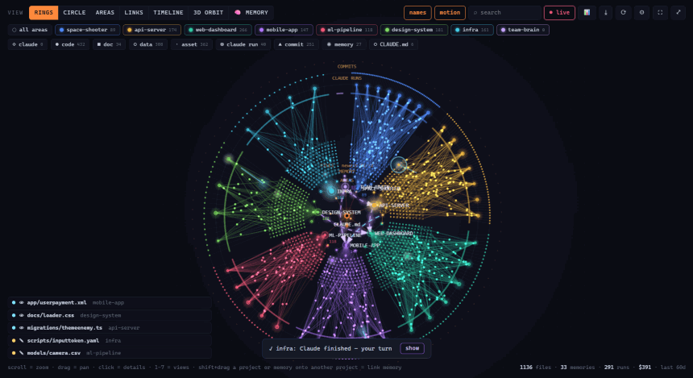
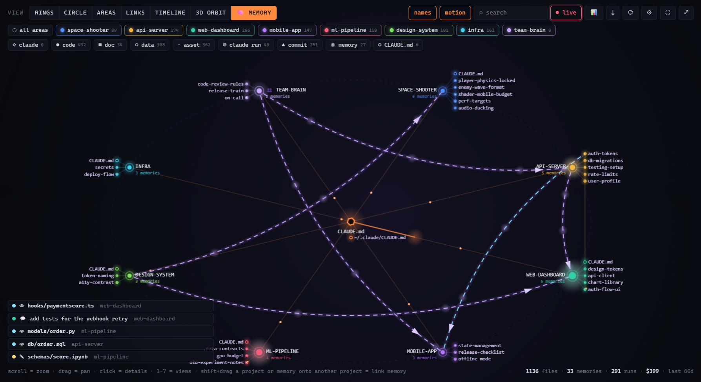
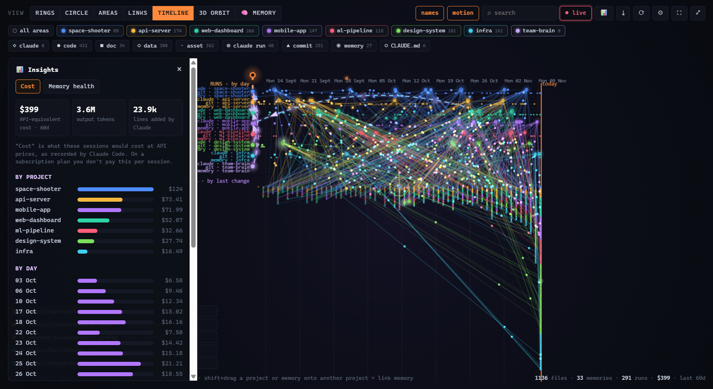

<div align="center">

# Synapse

**A living map of your Claude Code projects, plus memory you can link between them.**

See every session, file, commit and memory note Claude has touched, watch Claude work in real time,
and connect what one project learned to another with a drag.



<sub>Demo mode with fictional projects. Your data never leaves your machine.</sub>

</div>

---

## Why

Claude Code keeps **memory per project folder**. What it learned in `api-server` (your auth rules,
your DB conventions) is invisible to a session in `web-dashboard`. Sessions in different projects
can't share knowledge; you end up repeating yourself.

Synapse shows you all of it on one map, and lets you **link memory between projects**:
drag `api-server` onto `web-dashboard`, and every new Claude session in `web-dashboard` can read
`api-server`'s memory.

## Features

| | |
|---|---|
| 🗺️ **7 animated views** | Rings, Circle, Areas, Links, Timeline, 3D Orbit and Memory. The same data, seen 7 ways. |
| 🧠 **Memory map** | Every memory note and `CLAUDE.md`, the `[[links]]` between notes, and which sessions read or wrote them. |
| 🔗 **Link memory** | Drag a project (or a single note) onto another project. Undo with ✕. Backed up first. |
| 🔴 **Live mode** | Watch Claude read and edit files in real time: beams, flashes and a running ticker. |
| ▶️ **Session replay** | Replay any session's file activity in order. |
| 💸 **Cost insights** | API-equivalent cost per project, per day and per session, plus lines added and tokens. |
| 🩺 **Memory health** | Notes missing from `MEMORY.md`, broken `[[links]]`, near-duplicates and stale notes. |
| 👥 **Team memory** | Point Synapse at a shared folder of notes (e.g. a git repo) and link it into any project. |
| 🔌 **MCP server** | Claude itself can search memory across all projects, check activity and link memory. |
| 🎬 **Export** | Save a PNG or record a short video of your map to share. |

<table><tr>
<td></td>
<td></td>
</tr><tr>
<td align="center"><sub>Memory view: projects, their notes, and the links between them</sub></td>
<td align="center"><sub>Insights: cost per project, per day, per session</sub></td>
</tr></table>

## Install

Download the installer for your system from **[Releases](https://github.com/AmuriiOG/synapse-brain-map/releases)**:
Windows (`.exe`), macOS (`.dmg`), Linux (`.AppImage` / `.deb`).

> The builds are not code-signed yet. Windows SmartScreen: *More info → Run anyway*.
> macOS: right-click the app → *Open* the first time.

Or run from source (Node 20+):

```bash
git clone https://github.com/AmuriiOG/synapse-brain-map.git
cd synapse-brain-map
npm install
npm start            # your real Claude Code data
npm run demo         # fictional demo data, nothing read from disk
```

## How memory linking works

Claude Code loads each project's `~/.claude/projects/<project>/memory/MEMORY.md` at the start of
every session. When you link **A → B**, Synapse appends **one marked line** to B's `MEMORY.md`:

```markdown
- [Linked memory: api-server](…/api-server/memory/MEMORY.md) — memory index of the api-server project; read it when the task touches api-server … <!-- synapse:link -->
```

New sessions in B see the pointer and read A's memory when it's relevant.

- Only that marked line is ever added or removed. The rest of your file is never touched.
- A timestamped backup of `MEMORY.md` is saved before every change (⚙ → *open backups folder*).
- It isn't live: sessions that are already open read memory when they start. Start a new session, or
  ask the running one to re-read its memory.

## Use it from Claude (MCP)

Open ⚙ Settings and copy the command under *Let Claude use Synapse*, or from source:

```bash
claude mcp add synapse --scope user -- node /path/to/synapse-brain-map/src/mcp.js
```

Then ask Claude things like *"which of my projects has notes about auth tokens?"* or
*"link the api-server memory into this project"*.

| Tool | What it does |
|---|---|
| `list_projects` | projects, memory size, last activity, cost |
| `search_memory` | search notes and `CLAUDE.md` across every project |
| `read_memory` | read one note in full |
| `project_activity` | recent sessions, most-edited files, commits |
| `memory_health` | memory problems to fix |
| `link_memory` / `unlink_memory` | the same marked-line linking as the app (Claude Code asks you first) |

## Privacy

Synapse is **100% local**. It makes no network requests and has no telemetry. It reads
`~/.claude/projects`, `~/.claude/CLAUDE.md` and your project folders. The only thing it ever writes
is the marked line in a project's `MEMORY.md` when you link memory (plus its own settings and backups).

## Settings

⚙ in the toolbar:
- how many days of history to show
- which folders to skip: presets for Unity, Node/Web, Python, Android/iOS, Rust/Go/Java and Unreal/Godot, plus your own
- hide projects, add extra folders
- team memory folders

## Keyboard

`1`–`7` views · `F` fit · `Esc` close · scroll to zoom · drag to pan · **Shift+drag** a project or note onto a project to link memory

## Development

```bash
npm test              # core + live-mode tests (what CI runs on Windows, macOS, Linux)
npm run test:ui       # UI smoke test
npm run record-demo   # regenerate docs/demo.gif from demo data
npm run dist          # build installers for your OS
```

Project layout:
- `src/core/claude.js` is the **only** file that knows Claude Code's on-disk formats. If a Claude Code update changes them, fix it here.
- `src/core/scan.js` builds the map.
- `src/core/memory.js` handles linking.
- `src/core/live.js` is live mode.
- `src/mcp.js` is the MCP server.
- `src/renderer/index.html` is the UI (one canvas, no framework).

Contributions welcome. Please open an issue first for big changes.

## Disclaimer

Synapse is an independent open-source project. It is not made by or affiliated with Anthropic.
"Claude" and "Claude Code" are trademarks of Anthropic.

## License

[MIT](LICENSE)
